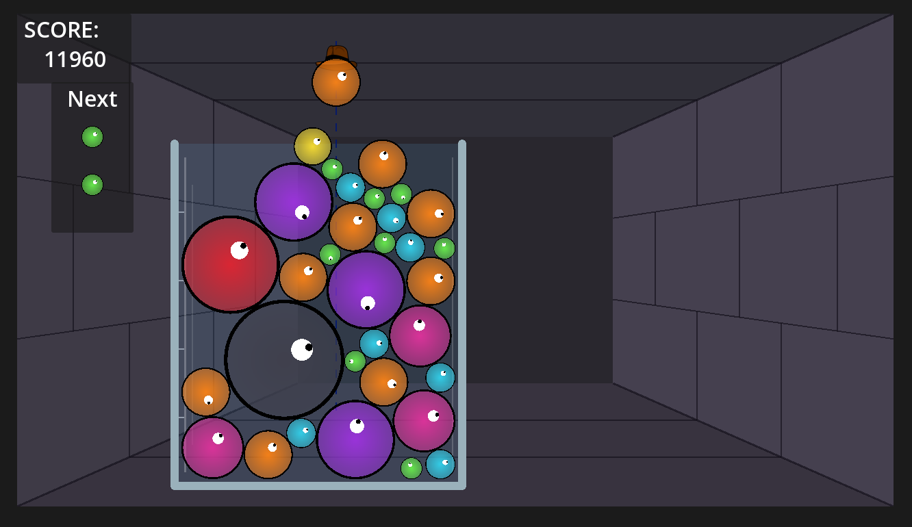

# Oozecrawler 🧪✨

> **Suika Game meets Dungeon Crawler Roguelite!** A 2D physics-merge puzzle RPG built with **Godot 4**.

[](https://godotengine.org)
[](https://docs.godotengine.org/en/stable/tutorials/scripting/gdscript/)
[](LICENSE)

<p align="center">
  
</p>

> [!NOTE]
> **Learning by Doing Project:**  
> Oozecrawler is an open-source, hands-on learning project exploring Godot 4, 2D physics, procedural rendering, custom canvas shaders, and clean decoupled game architecture in GDScript.

---

### 📌 GitHub Pinned Card Blurb
```text
A learn-by-doing Godot 4 project combining Suika-style physics puzzle mechanics with dungeon crawler roguelite elements.
```

---

## 🕹️ Current Project Status

The foundational mechanics of the physics puzzle loop, procedural art, event architecture, and audio feedback are currently implemented and functional:

### ✅ Implemented Features

- **11-Tier Slime Hierarchy & Merge Physics:**
  - Full progression across 11 tiers (from tiny Tier 1 *Droplet* up to Tier 11 *Golden Royal Ooze*).
  - Scaled physics parameters per tier: radius, mass, elasticity, and score values.
  - Cascade merge collision logic (`_merge_with`) with pop impulses and cleanup.
- **Dynamic Tier-Scaled Merge Audio (SFX):**
  - Integrated `AudioStreamPlayer` triggered on merge events via the global `Events` bus.
  - Dual-sample sound design: acute pops for Tiers 1–5 and heavier tones for Tiers 6–11.
  - Dynamic procedural pitch scaling (`pitch_scale`) ramping up pitch per tier for an ascending musical crescendo.
- **Custom Slime Canvas Shader:**
  - Procedural 2D fragment shader (`slime.gdshader`) with radial alpha gradients, stylized dark borders, and responsive directional eyes.
  - Per-instance material duplication dynamically applied across all slime tiers.
- **Two-Bag Queue Manager (`QueueManager`):**
  - Dual-buffer bag randomization system (`_primary` and `_secondary`) with fair distribution shuffling.
  - Multi-step queue lookahead (`peek()`) ensuring deterministic upcoming slime previews.
- **Mouse-Aimed Dropper:**
  - Smooth mouse tracking clamped dynamically to container wall boundaries.
  - Height auto-calibrated above the container flask opening.
  - Dashed trajectory aim guide and live shader preview of the loaded slime.
  - Cooldown timer preventing rapid drop spam.
- **Alchemical Flask Container:**
  - `StaticBody2D` boundary walls with custom procedural glass drawing (`_draw`).
  - Translucent liquid/glass tint, specular highlight streaks, and graduated volume tick marks.
  - Dynamic boundary calculation methods (`get_drop_bounds()`, `get_opening_y()`) replacing hardcoded scene coordinates.
- **Procedural Dungeon Corridor Background:**
  - Perspective-projected corridor background rendered procedurally with stone floor, ceiling, and staggered mortar block patterns.
- **Global Event Bus & HUD:**
  - Autoloaded `Events` singleton decoupling gameplay systems from UI.
  - Live HUD tracking accumulated merge score and displaying upcoming queued slimes.

---

## 🗺️ Roadmap & Release Milestones

Development is structured around a playable **Launch MVP (v0.1 Beta)** followed by iterative major content updates (the *Rogue Adventure* live-ops model):

### Phase 1: Launch MVP — Version 0.1 Beta (Current Focus)
- [ ] **Dual Loss Conditions:** Overflow danger line with 2–3s countdown timer + Player HP tracking.
- [ ] **Turn-Based Combat Bridge:** AP economy (drops/turn), Attack/Defense Stance toggle (Damage Bank vs. Shield Bank), and physics settling phase.
- [ ] **Modular Damage Engine:** `Damage = ((Base + Flat) * ChainMult) * CritMult`.
- [ ] **Scripted Enemy Encounters:** Deterministic `action_loop: Array[int]` with telegraphed intent icons (Normal Enemy, Mid-Boss, Boss).
- [ ] **5-Node Linear Run:** `Enemy` ➔ `Event` ➔ `Shop` ➔ `Mid-Boss` ➔ `Boss` with post-combat flask resets and gold economy.
- [ ] **Endless Mode:** Classic large-beaker physics puzzle with local high-score saving (`user://`).
- [ ] **Corridor Motion & Visual Juice:** Step-forward background animations, turns/forks between rooms, merge party-popper bursts (`CPUParticles2D`), and floating combat numbers.
- [ ] **Audio & SFX:** Slime squish, bounce, and flask glass impact sound design.


### Phase 2: Major Update 1 — Hero Classes & Skill Loadouts
- [ ] 🪓 **Barbarian:** *Force Throw* downward launch impulse and *Quake Slam* vial jarring.
- [ ] 🧙 **Wizard:** *Slime Magnetism* combos and *Transmutation* tier shifts.
- [ ] 🗡️ **Rogue:** *Slime Lubrication* gap squeezing and *Sneak Drop* precision.
- [ ] **Endless Loadouts:** Pre-run card/trait selection for Endless Mode.

### Phase 3: Major Update 2 — Container Variations & Hazards
- [ ] **Erlenmeyer (Conical) Flask:** Wide base with restrictive narrow neck.
- [ ] **Test Tube:** Tall vertical column demanding precision stacking.
- [ ] **Round-Bottom Flask:** Curved circular bowl rolling slimes toward center.
- [ ] **Obstacle Flasks:** Pegs and dividers that split and redirect falling slimes.

### Phase 4: Major Update 3 — Full Dungeon Crawl & Advanced AI
- [ ] **Procedural Branching Map:** Node navigation with branching paths, elite shrines, and mystery events.
- [ ] **Advanced Enemy Disruption:** Non-mergeable junk slimes, pegs placed during combat, and frozen slimes.
- [ ] **Curse Modifiers:** Persistent board malus (flask does not reset between battles).
- [ ] **Expanded Card & Relic Deck:** Dynamic in-run consumable cards and passive relics.

### Phase 5: Platform Release & Meta-Progression
- [ ] **Cross-Run Meta Economy:** Unlocks for starter flasks, perks, and class abilities.
- [ ] **Achievement Architecture:** Decoupled `AchievementManager` supporting offline storage, Steamworks, and mobile platforms.

---

## 🛠️ Engine & Tech Stack

- **Engine:** [Godot Engine 4.x](https://godotengine.org) (Compatibility Renderer)
- **Language:** GDScript 2.0 (statically typed)
- **Architecture:** Node composition, custom CanvasItem shaders, decoupled Autoload Event Bus
- **Physics:** Godot 2D Physics (`RigidBody2D`, custom damping, restitution, and collision filtering)
- **Target Platforms:** PC (Steam / Itch.io) with mobile-ready touch architecture

---

## 📁 Repository Structure

```text
oozecrawler/
├── assets/                # Textures, audio, icons, prototyping graphics
│   └── audio/             # Wave samples (.wav) and SFXR parameter configs (.json)
├── docs/                  # Architecture, GDD, and design roadmaps
│   ├── Screenshots/       # Gameplay screenshots and visual assets
│   ├── GDD.md             # Game Design Document
│   ├── IDEAS.md           # Mechanics backlog & class ability concepts
│   └── CURRICULUM.md      # Godot 4 & GDScript learning roadmap
├── scenes/                # Scene tree components (.tscn)
│   ├── Core/              # Container, Dropper, Dungeon Background, Main
│   ├── slimes/            # RigidBody2D slime scenes
│   └── test/              # Shader & mechanic prototypes
├── scripts/               # GDScript source code (.gd)
│   ├── autoload/          # Global Event bus singletons
│   ├── characters/        # Dropper controller
│   ├── core/              # Main game loop, QueueManager, procedural visuals
│   └── Slimes/            # Slime physics, tier table, and shader setup
├── Shaders/               # Custom visual shaders (.gdshader)
└── project.godot          # Engine configuration & project settings
```

---

## 📚 Documentation Links

- [Game Design Document (GDD)](docs/GDD.md)
- [Feature & Mechanics Backlog](docs/IDEAS.md)
- [Learning Curriculum & Tutoring Roadmap](docs/CURRICULUM.md)

---

## 📄 License

Distributed under the [MIT License](LICENSE).

